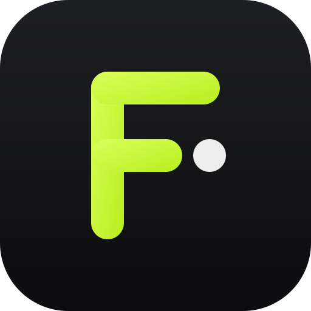
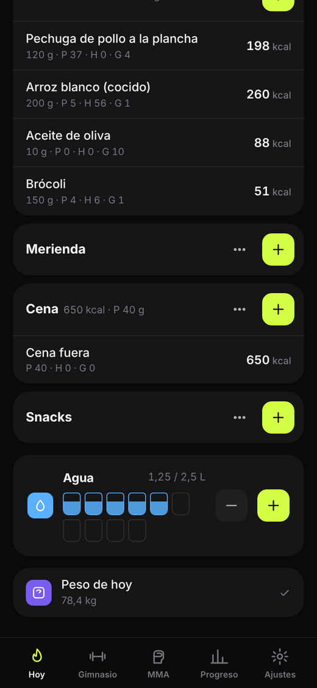
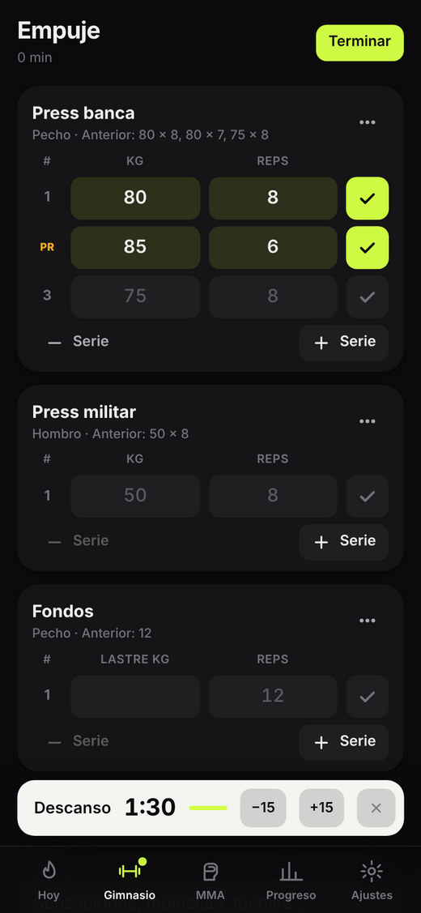
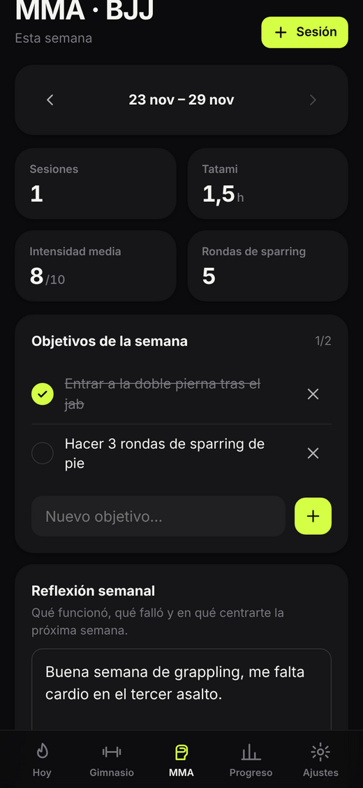

<p align="center"></p>
<h1 align="center">Forja</h1>
<p align="center">Calorías, gimnasio y MMA en una sola app.<br>Minimalista, rápida, sin cuentas y sin conexión. Pensada para iPhone.</p>

<p align="center">
  &nbsp;
  &nbsp;
  
</p>

---

## Funciones

### Nutrición (Hoy)
- Anillo de calorías con objetivo, consumido y restante, y barras de proteína, hidratos y grasa.
- Comidas configurables (Desayuno, Comida, Merienda, Cena, Snacks).
- **Añadir en un toque**: el botón **+** de cada alimento usa tu cantidad habitual. Si tocas el nombre, puedes elegir los gramos o la porción y ver los macros en directo.
- Buscador con **recientes**, **comidas guardadas** (añade tu desayuno de siempre de golpe), **mis alimentos** y unos 120 alimentos comunes incluidos.
- **Open Food Facts**: busca productos de supermercado por nombre o por **código de barras** y se guardan para usarlos sin conexión.
- **Calorías rápidas** para comidas fuera de casa.
- Copiar una comida del día anterior, editar o borrar con deshacer, y navegar entre días.
- Agua por vasos y peso diario.
- **Calculadora de objetivos**: fórmula Mifflin-St Jeor + actividad, con objetivo de perder grasa, mantener o ganar músculo, ritmo semanal, proteína por kg y porcentaje de grasa.
- Calorías extra opcionales los días que entrenas.

### Gimnasio
- Rutinas (Empuje, Pierna, Fuerza MMA…) que se empiezan con un toque.
- Cada serie muestra los valores del último entreno: pulsar ✓ los acepta, así que repetir es un toque por serie.
- Ejercicios con peso, peso corporal (con lastre) o tiempo; más de 70 incluidos y los que quieras crear.
- **Detección de récords** (1RM estimado de Epley), temporizador de descanso con aviso, volumen por sesión.
- Historial, gráfica de progresión por ejercicio, y opciones de repetir un entreno o guardarlo como rutina.

### MMA · BJJ
- Vista **semana a semana**: sesiones, horas de tatami, intensidad media (RPE) y rondas de sparring.
- **Objetivos semanales** con check, y opción de traer los pendientes de la semana anterior.
- **Reflexión semanal**.
- Sesiones por tipo (BJJ Gi, No-Gi, MMA, Striking, Lucha, Sparring, Físico) con *qué trabajé*, *qué funcionó* y *a mejorar*.
- **Perfil de luchador**: cinturón y grados, récord, categoría, estilo, plan de juego, juego A, fortalezas y debilidades.
- **Biblioteca de técnicas** por categoría y estado (aprendiendo, practicando, dominada).
- **Próxima competición** con cuenta atrás y distancia a tu peso de combate.

### Progreso
- Peso con media móvil de 7 días, cambios a 7 y 30 días, y peso objetivo.
- Calorías de 7, 14 o 30 días frente a tu objetivo, días dentro del objetivo (±10 %), racha y macros medios.
- Resumen de entrenamiento de 30 días.

### Extras
Tema claro u oscuro, copia de seguridad (exportar e importar JSON) y funcionamiento sin conexión.

---

## Publicar en GitHub Pages

1. Crea un repositorio (por ejemplo `forja`) y sube **el contenido** de esta carpeta, con `index.html` en la raíz.
2. Ve a **Settings → Pages → Deploy from a branch → `main` → `/ (root)` → Save**.
3. En un par de minutos estará en `https://TU_USUARIO.github.io/forja/`.

## Instalar en el iPhone

Abre la URL en **Safari** → **Compartir** → **Añadir a pantalla de inicio**. Deja activado **Abrir como app web** → **Añadir**. Ábrela siempre desde el icono.

## Notas

- **Código de barras en iPhone:** Safari no permite leer códigos con la cámara desde una web. Escribe el número o, en el campo, mantén pulsado y elige **Escanear texto** para leerlo con la cámara. En Chrome para Android y en algunos ordenadores el escáner de cámara funciona directamente.
- **Precisión:** los alimentos comunes usan valores medios (BEDCA/USDA) con los hidratos sin fibra, como en las etiquetas europeas. Para tus productos habituales es más preciso crear el alimento con su etiqueta o usar el código de barras.
- **Datos:** todo se guarda en el dispositivo (`localStorage`). Exporta una copia de vez en cuando desde Ajustes.
- Las recomendaciones de calorías son estimaciones y no sustituyen el consejo de un profesional sanitario.

## Desarrollo

```
├── index.html, manifest.webmanifest, sw.js
├── css/styles.css          Sistema de diseño (claro/oscuro)
├── icons/                  Logo e iconos
├── js/forja.js             Script generado (no editar)
├── build.mjs               Genera js/forja.js a partir de src/
└── src/                    Código fuente (módulos ES)
    ├── app.js, router.js, store.js, ui.js, utils.js, charts.js, sound.js
    ├── foods.js            Base de alimentos
    ├── exercises.js        Biblioteca de ejercicios
    ├── nutrition.js        Calculadora de objetivos
    ├── off.js              Open Food Facts
    └── views/              today, gym, mma, progress, settings
```

Para hacer cambios: edita `src/`, ejecuta `node build.mjs`, sube el valor de `VERSION` en `sw.js` y publica. Las apps instaladas mostrarán «Hay una nueva versión».

Licencia MIT.
